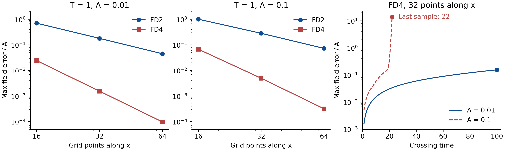

# B1 results — run 01, 2026-11-08

Registration: [B1_GAUGE_WAVE.md](B1_GAUGE_WAVE.md), commit `d5ac32a` (pushed before the run).
Output: `outputs/b1-20261108-01/` (local, ignored); summary copied to
[b1-summary-20261108.json](b1-summary-20261108.json).
Status: **PASSED** — all eight B1-a order estimates and B1-b pass; B1-b′ (reported only) blew up after the sample at t = 22.



The plot uses the six [saved numerical output files](b1-gauge-wave/) from the original
run. B1-b′ ends at its last saved sample. The [traceback](b1-gauge-wave/log-long-0.1.txt)
records the positivity check that stopped the evolution. The two convergence
panels share a vertical scale. The time-history panel has a logarithmic error axis.

Disclosure: the first `summarize` call crashed while writing JSON (a numpy bool in the
`complete`/`passed` flags). The fix casts those two expressions to `bool`; no threshold, window
or input changed, and the run outputs were not touched. The same latent bug in
`run_b2.summarize_long` was fixed before B2-c finished.

## B1-a — convergence to the exact gauge wave, T = 1, dt = 0.1 h

Error = max over grid and evolved fields of |numerical − exact| ÷ A.

| Case | Errors at Nx = 16 / 32 / 64 | Observed orders | Window | Result |
| --- | --- | --- | --- | --- |
| A = 0.01, FD2 | 0.700 / 0.179 / 0.0448 | 1.97, 2.00 | [1.7, 2.3] | pass |
| A = 0.01, FD4 | 2.42e-2 / 1.55e-3 / 9.71e-5 | 3.97, 3.99 | [3.7, 4.3]; E64 ≤ 1e-3 | pass |
| A = 0.1, FD2 | 1.00 / 0.282 / 0.0725 | 1.83, 1.96 | [1.7, 2.3] | pass |
| A = 0.1, FD4 | 6.74e-2 / 4.95e-3 / 3.17e-4 | 3.77, 3.97 | [3.7, 4.3]; E64 ≤ 1e-3 | pass |

At A = 0.1 the coarse-grid orders sit lower (1.83, 3.77), as expected when the nonlinear
terms make the Nx = 16 grid less asymptotic; the fine-pair orders are 1.96 and 3.97.

## B1-b — long run, A = 0.01, FD4, Nx = 32, dt = 0.25 h, T = 100 (pass)

| t | 1 | 10 | 20 | 30 | 40 | 50 | 60 | 70 | 80 | 90 | 100 |
| --- | --- | --- | --- | --- | --- | --- | --- | --- | --- | --- | --- |
| err ÷ A | 1.55e-3 | 1.54e-2 | 3.05e-2 | 4.52e-2 | 5.95e-2 | 7.38e-2 | 8.84e-2 | 0.104 | 0.120 | 0.137 | 0.154 |

Late log-slope over [50, 100] = 0.0146 per crossing (gate ≤ 0.02); error at T = 100 = 0.154
(gate ≤ 1). Wall time 4578 s, single thread.

Reading: the error grows almost exactly linearly, err/t ≈ 1.5e-3 per crossing, which equals the
one-crossing truncation error. That is accumulated phase error of a stable scheme, not an
instability. Limitation of the gate: pure linear growth e ∝ t has a log-slope of 1/t, which is
0.013–0.014 on [50, 100], so the 0.02 threshold separates linear from exponential growth only
by a factor of about 1.4 on this window; the linear fit above is the stronger evidence.

## B1-b′ — same with A = 0.1 (reported only; blew up)

| t | 1 | 5 | 10 | 15 | 18 | 19 | 20 | 21 | 22 |
| --- | --- | --- | --- | --- | --- | --- | --- | --- | --- |
| err ÷ A | 4.96e-3 | 2.50e-2 | 5.85e-2 | 0.111 | 0.146 | 0.174 | 0.367 | 1.75 | 13.9 |

Linear growth (≈ 5e-3 per crossing) until t ≈ 18, then exponential growth at about
1.8 e-folds per crossing; the run stopped at t = 22 when chi and lapse turned non-positive.
Large-amplitude gauge-wave runs are known to fail this way for many formulations (the AwA
papers report similar behaviour for several codes); this is why B1-b′ was registered as
reported only. Damping (kappa1 > 0), a lapse floor or a different slicing are possible
follow-ups and would each need a new registration.

## What this means

Harmonic slicing on top of the frozen FO-CCZ4 RHS reproduces the nonlinear AwA gauge wave with
the designed orders at both amplitudes and evolves the small-amplitude wave for 100 crossings
with only linear phase drift. It does not yet survive the large-amplitude long run.

## Reproduce

Use Python 3.12 and `requirements-minimal.txt`. Replot the recorded data with
Matplotlib 3.11.2 (needed only for plotting).

```console
python -B -m experiments.b1_gauge_wave.plot --input docs/b1-gauge-wave --output outputs/b1-error-curves.png
```

The following PowerShell commands recompute the registered cases using a fresh
output directory. Each short run selects one amplitude and order and evaluates
all three grids. The original NumPy small-amplitude long run took about 76 minutes,
so run the long cases only when the machine can accommodate them. The reported-only
large-amplitude case can exit with the positivity error after writing partial samples.

```powershell
$out = 'outputs/b1-new'
New-Item -ItemType Directory -Path $out -ErrorAction Stop | Out-Null
foreach ($amplitude in '0.01', '0.1') {
    foreach ($order in 2, 4) {
        python -B -m experiments.b1_gauge_wave.run_b1 converge --amplitude $amplitude --order $order --out $out
        if ($LASTEXITCODE -ne 0) { throw 'B1 convergence run failed' }
    }
}
python -B -m experiments.b1_gauge_wave.run_b1 long --amplitude 0.01 --out $out
if ($LASTEXITCODE -ne 0) { throw 'Gated B1 long run failed' }
python -B -m experiments.b1_gauge_wave.run_b1 long --amplitude 0.1 --out $out
python -B -m experiments.b1_gauge_wave.run_b1 summarize --out $out
```

The summary records `null` for the unavailable fit when a long case stops early.
The historical summary retains its original `Infinity` sentinel. The scope,
reference solution and acceptance thresholds are those in the original registration.
