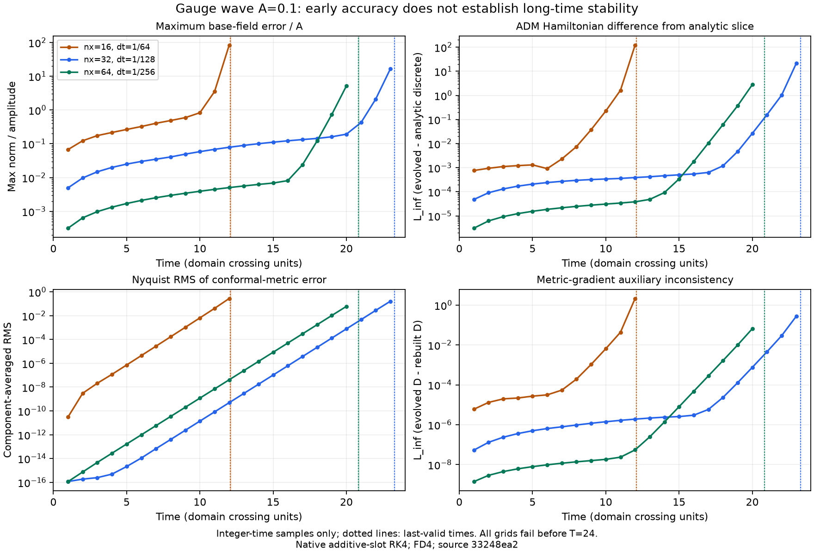
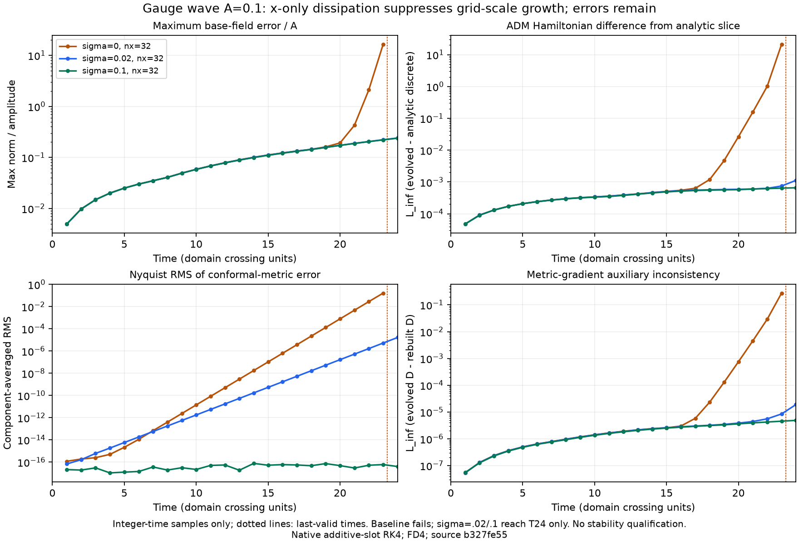
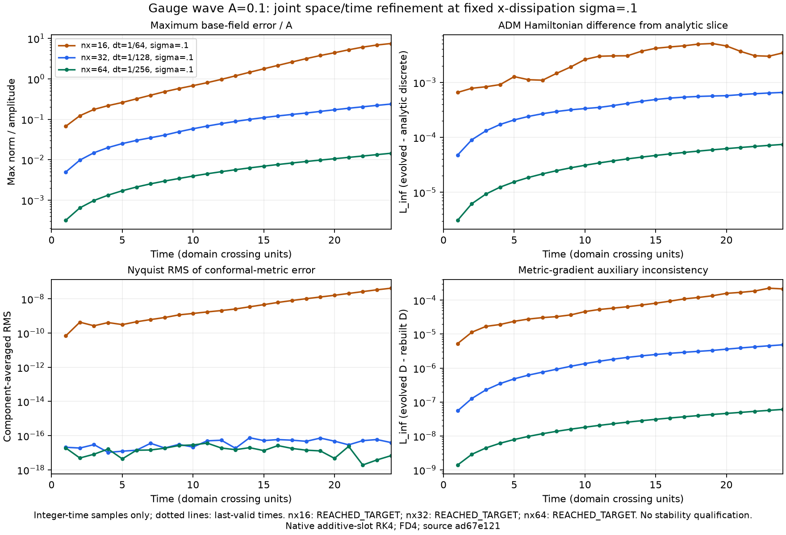
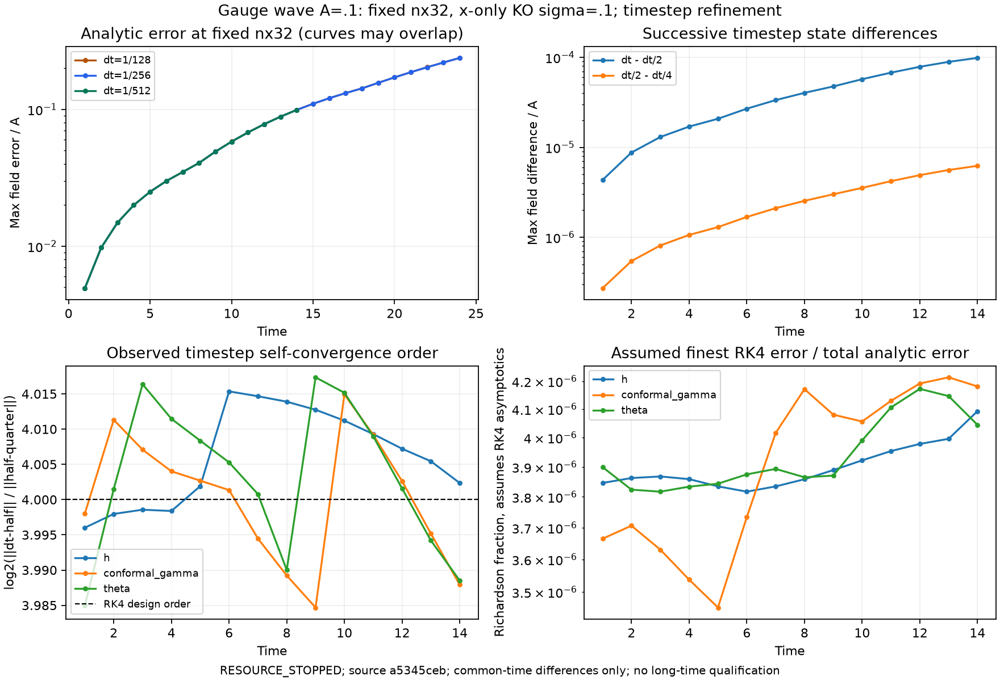

# S3 large-amplitude stage and roundoff-sensitivity diagnostic

Registered 2026-11-14 before this experiment. Existing B1/S3 gates remain unchanged.
Same 32x5x5 periodic grid, FD4, A=.1, harmonic slicing, zero shift, kappa1=0,
dt=1/128, native threads=1. One invocation is bounded by 600 s / 64 MiB output.

1. Evolve baseline and a second trajectory whose initial h00 slot at (x-index8,y0,z0)
is moved by exactly one representable float toward +infinity. All other slots retain
the same bytes. This deliberately perturbs auxiliary consistency at roundoff scale;
it is a sensitivity test, not a replacement initial-data or science acceptance test.
2. At baseline crossing times 0,1,10,15,17,18,20,22 compare Python harmonic RHS
and native harmonic RHS on the SAME four native RK4 stage input states. Pack all
58 RHS slots, retain per-slot absolute/relative difference and active-slot mask
(max reference magnitude >1e-10 of global RHS scale). Existing RHS comparison
criterion for active slots is <=1e-12 relative. Inactive differences are still reported.
3. At each common crossing report every slot difference and normalized analytic
solution error for both trajectories. Keep original saved Python comparison separate.
4. No positive attribution is pre-assumed. RHS equality on these states cannot prove
all equations correct; sensitivity alone cannot prove the historical discrepancy is
solely roundoff. A detected mismatch remains a failure requiring source inspection.
5. Preserve selected baseline slot snapshots for subsequent offline same-state checks;
no recomputation of evolved auxiliary fields. No external independent reproduction
is claimed by this experiment.


## Measured result

Completed both trajectories to T=22 in 145.07 s, peak working set 46.12 MiB.
The baseline analytic errors are exactly equal to the previously saved native errors
at every common crossing. Same-state comparisons cover all 32 registered stages.
Largest absolute RHS difference is 2.66454e-15. Four stages at T=0 fail the original
1e-12 active-slot relative gate (Theta: up to 5.00895e-12 relative, with absolute
Theta difference only 5.54e-16 and Theta RHS magnitude about 1.11e-4). The later
28 stages pass that relative gate. Overall strict stage comparison remains FAILED;
the criterion has not been widened to absorb cancellation in a small component.

One initial h00 ULP is 1.11022e-16. At T=22 the two native states differ by 2.15135
in the worst canonical slot, an amplification of 1.93776e16. Between T=5 and18,
the fitted log-difference growth rate is 1.78312 per crossing. Analytic normalized
errors at T=22 are 2.09843 (baseline), 21.31915 (one ULP), versus saved Python
13.91410. This establishes severe finite-precision sensitivity on this test. Together
with machine-scale same-state RHS differences it supports roundoff amplification as
an explanation; it does not prove that the historical discrepancy is solely roundoff,
nor validate the unstable long-time trajectory. External reproduction remains absent.

Raw results, four baseline slot snapshots, offline summary and actual-data figure:
gauge-stage/. Re-analyze without evolving:

    python -B -m experiments.b3_native.analyze_stage_diagnostic docs/gauge-stage --null-result docs/s2-null-modes.json --plot

Registration 407dc07; numerical source 9009ade. Three targeted diagnostic tests pass.


## Prospective Theta term isolation (2026-11-14)

Roadmap S3: locate the four T=0 active-slot failures without changing the
1e-12 gate or the original trajectories. Before measuring the new output:
add an optional native diagnostic export of the six additive Theta terms and
its scalar/extrinsic/Z inputs, sharing the production cell routine. Check that
all 58 outputs remain bit-identical to the uninstrumented library on the four
registered T=0 RK4 stage states (32x5x5, dt=1/128, A=.1). Compare each diagnostic
term against the frozen Python equation on the same input bytes. Report maximum
absolute difference, cancellation ratio, reconstruction error and strict slot
comparison. A term localization does not establish a pure-roundoff cause.

No evolution long run is needed. Single process/thread, <=600 s and <=64 MiB
output; <=512 MiB working-set target. Use a new output directory. Original
science sources, gates and saved failure records are retained unchanged.


### Registered inverse-algorithm ablation

Following term isolation, compare the same four T=0 inputs with a Python-only
copy of the frozen functions whose geometry uses the native 3x3 adjugate
formula instead of NumPy LU. Clone function globals locally; do not replace
NumPy or production-module globals. Keep every derivative, RHS term, stage
input and scientific threshold fixed. Report both original and ablated
comparisons, whether the original implementation is bitwise unchanged after
calling the variant, and matrix-inverse error against LU on nonsingular
positive-definite fixtures. Do not assume the variant improves the discrepancy
or adopt it into the solver. Same <=600 s /64 MiB resource envelope.


## Theta term isolation and inverse ablation: measured result

Instrumentation shares the native cell routine. All 58 outputs are bitwise equal
both to ordinary calls and to the original-library four-stage arrays saved before
instrumentation (original kernel at eefba50; registration e9027ff). The frozen
Python science sources are unchanged. Both six-term reconstructions reproduce
Theta exactly on these states.

| T=0 stage | Original worst active-slot relative error | Adjugate variant | Strict 1e-12 variant gate |
| --- | --- | --- | --- |
| 1 | 5.00894654e-12 | 3.98868563e-12 | FAIL |
| 2 | 4.98167522e-12 | 4.95184685e-12 | FAIL |
| 3 | 3.79573324e-12 | 1.17154520e-12 | FAIL |
| 4 | 4.66511481e-12 | 3.77153271e-12 | FAIL |

The dominant absolute mismatch lies in the curvature contribution
0.5*alpha*e^2*(R+2 div Z). Across the four stages its maximum difference is
4.51e-16 to 7.30e-16; lapse and chi are bitwise equal. At each stage's worst
Theta point the six-term cancellation ratio is only 1.000 to 1.076. Therefore
cancellation in the **final six-term accumulation** is not supported as the
dominant explanation at those points. This says nothing definitive about
cancellation inside the geometry construction.

The isolated adjugate-inverse variant reduces some discrepancies but all four
strict stage gates still fail. A change of inverse algorithm alone is insufficient
on these inputs. It is not a solver fix and has not been adopted into production.
Calling the variant leaves the original Python outputs and NumPy/module globals
unchanged. This ablation neither validates long-time stability nor proves that
all historical trajectory differences are solely roundoff.

The final ablation took 0.544 s with peak working set 53.13 MiB. All outputs (including the original-library baseline and earlier diagnostic runs)
total 369640 bytes, below the 64 MiB cap. Numerical source commit: 32a4bfb. Thirty-three related tests passed, including native
RHS, RK4, SBP, harmonic lapse, long-run controls, null-mode diagnostics, strong-field
foundations, nonzero transport/damping, term reconstruction and ablation isolation.

Raw arrays and reports: [theta-terms/](gauge-stage/theta-terms/). Reproduce with a fresh output directory:

```console
python -B -m kernel.native_rhs build
python -B -m experiments.b3_native.theta_terms --out outputs/theta-terms-reproduction --before docs/gauge-stage/theta-terms/before.npz --inverse-ablation
```

Next localization target: the Ricci/Z geometry contractions and derivative
accumulation orders, on the same stage inputs. External independent reproduction
remains absent; the original strict RHS gate remains failed.


## S3 geometry localization registration (2026-11-14)

Before implementation or measurement: use the saved four T=0 RK4 inputs in
`theta-terms/before.npz`, A=0.1, 32x5x5 FD4, single thread. Export actual native
inverse metric, raised metric derivatives, Christoffels and their derivatives,
Ricci, Z derivative and scalar intermediates through an opt-in entry point.
Observe the corresponding frozen Python geometry locals, for both original and
isolated adjugate inverse. Compare tensors and recompute scalar contractions with
native sequential accumulation as a diagnostic only. Verify all 58 native outputs
against saved original-library outputs and ordinary calls; keep original Python
globals and outputs unchanged. No default arithmetic change and no integration.
Keep the strict 1e-12 gate, 600 s, 64 MiB output and 512 MiB working-set ceilings.
The experiment localizes arithmetic discrepancies; it cannot establish long-time
stability, causal uniqueness, or external independent reproduction.


### Geometry localization result and derivative-ablation registration

The ccdd2e7 run preserves every saved and ordinary native RHS bitwise. Original
Python outputs/globals are unchanged. All four strict stage gates still fail.
With isolated adjugate inversion, h_inverse, d_upup, both Christoffels, tilde_gamma
and both Z vectors agree bitwise on these four inputs. The earliest remaining
exported discrepancy is d_conformal_christoffel (max 2.22e-16), followed by
physical-Christoffel derivatives (4.44e-16). Replacing the final scalar contraction
with sequential accumulation changes no values here; upstream geometry differs.
This is a same-state arithmetic localization, not a stability result.
The first observer run compared raw RHS after in-place harmonic correction and
reported a false control failure; retained as initial-control-failure.json.
The corrected run compares before correction, with a four-stage regression test.

Before further implementation/measurement: native periodic d1 multiplies by a
precomputed reciprocal; frozen Python d1 divides by the denominator. Add isolated
Python geometry variants for reciprocal derivative arithmetic, alone and combined
with adjugate inversion; expose actual symmetrized D/P and GammaHat derivatives.
Use exactly the same four saved inputs and limits, no solver changes or evolution.
The original strict RHS gate stays unchanged. Bitwise geometry agreement would
identify these arithmetic choices on these inputs only, not validate the solver.


### Combined geometry arithmetic result and full-RHS ablation registration

At 2d4e320, adjugate inversion plus reciprocal stencil arithmetic reproduces all
397 exported geometry components bitwise at all four saved RK4 inputs. Either
change alone leaves discrepancies. All original native outputs remain unchanged;
the original Python strict RHS gate still fails. Runtime 1.209 s, peak 67.83 MiB.
The agreement covers these saved gauge-wave inputs, not general states or time
integration. Raw arrays and full reports: geometry-terms/arithmetic/.

Before implementation/measurement: clone the frozen volume function with isolated
adjugate geometry and reciprocal first_derivative; retain the original harmonic
wrapper's division arithmetic (matching native_evolve.harmonic_correction).
Compare all 58 full RHS outputs on the same four inputs at the unchanged 1e-12
active-slot relative gate, and show the original comparison alongside the variant.
The variant is diagnostic only; no solver default, science source, long-run gate
or external-reproduction status changes. Retain the same resource ceilings.


### Complete RHS arithmetic ablation: bounded result

Source ad9d661; same saved T=0 four-stage inputs, no evolution. All original
native RHS outputs remain bitwise equal to saved original-library outputs and
ordinary calls. Original Python output/globals/defaults stay unchanged.

| Stage | Original active-slot relative max | Isolated arithmetic variant | Original 1e-12 gate | Variant 1e-12 gate |
| --- | --- | --- | --- | --- |
| 1 | 5.00895e-12 | 6.15618e-14 | FAIL | PASS |
| 2 | 4.98168e-12 | 7.53579e-14 | FAIL | PASS |
| 3 | 3.79573e-12 | 3.60346e-14 | FAIL | PASS |
| 4 | 4.66511e-12 | 3.01284e-14 | FAIL | PASS |

All 397 exported geometry components agree bitwise for the combined inverse/stencil
variant. Full RHS absolute differences remain nonzero, at most 6.94e-18. Thus the
two arithmetic choices are sufficient to account for the strict-gate discrepancy
on these inputs to the registered tolerance, without establishing exact complete
RHS equality, general-state parity or long-time stability. The original gate
remains failed and no diagnostic variant replaces a solver default. In particular,
the T~23.28 failure boundary, S2-c boundedness and external reproduction stay open.
This diagnostic cost 1.569 s, 67.906 MiB peak and 839139 output bytes. Forty related
tests passed, including stencil accuracy, non-diagonal geometry reconstruction,
profiler restoration and whole-RHS ablation isolation. The 267-file constraint
bridge input manifest passed verification without executing its scientific run.

Raw output: [full-rhs/](gauge-stage/geometry-terms/full-rhs/). Reproduce in a fresh
output directory (single-thread BLAS/OpenMP environment recommended):

```console
python -B -m kernel.native_rhs build
python -B -m experiments.b3_native.geometry_terms --out outputs/geometry-reproduction --before docs/gauge-stage/theta-terms/before.npz
```

The process exit status qualifies instrumentation only. Inspect `strict_rhs_pass`
(original, false) and `diagnostic_arithmetic_rhs_pass` (isolated variant, true)
separately. Next: compare registered saved inputs near T=15-18, if available, or
register a resource-bounded acquisition; test the arithmetic explanation before
attributing the later trajectory divergence. No new long evolution was run here.


### Late saved-state arithmetic ablation registration (2026-11-14)

S3 acceptance advanced: localize implementation differences at later native
trajectory states without claiming trajectory agreement or stability.
Before implementation/measurement, use the existing baseline snapshots at T=15,
18 and 22, all shape 58x32x5x5, dt=1/128, FD4, A=.1, harmonic lapse, zero shift.
SHA256 in time order:
- 59321fbc12c4ac7e0a106dbcb4321b3bd4391f41ce4403db0699fec27ab1c276
- 9f8aafb872358a398af05b0b4a6d3bf4b548b0c2a4ae536086c8a8bf311d94a6
- 985410d1ba458b037a57e559ab2d52fde1ed12e47453ffc9165b9c276b3f3edb
Construct four RK4 inputs from ordinary native RHS evaluations of each snapshot;
this samples one step's inputs, with no trajectory advance. Compare original
Python/native and isolated inverse/stencil variants side by side at the unchanged
1e-12 active-slot gate, including the 397 actual geometry intermediates. Save each
input and output. Ordinary calls supply fresh controls here, not archived old-library
outputs. Preserve raw-before-correction and Python-restoration controls.
Each snapshot job retains 600 s / 64 MiB output / 512 MiB working-set ceilings,
single-thread BLAS/OpenMP. No default solver or frozen science edits. No claim of
external independent reproduction or completion of the frozen 8^3 experiment.


### Late same-state result (source 9460109)

All twelve native-generated RK inputs at T=15/18/22 passed the **original**
1e-12 active-slot comparison. Worst original relative differences over four stages
are respectively 5.40275e-14, 4.20536e-14 and 2.08911e-15. The diagnostic arithmetic
variant maxima are 3.77155e-16, 3.33318e-16 and 1.24521e-16. Its 397 geometry
components agree bitwise at every input. Full RHS differences are nonzero in eleven
cases (at most 5.55112e-17); T22 stage4 is bitwise equal. These late controls are
fresh ordinary calls, not an old-library replay. Raw inputs/outputs: geometry-terms/late/.
Original-output preservation and observer controls all pass. Each job took 1.33-1.44 s,
peaked below 66.68 MiB and wrote less than 0.84 MiB. Eighteen related tests passed.
This excludes a sampled late local RHS discrepancy above the registered gate;
it does not establish the cause of accumulated trajectory divergence. The failed
T0 original gate, native failure boundary, S2-c and external reproduction remain open.


### Short identical-snapshot restart registration (2026-11-14)

Before implementation/measurement: restart the registered T22 native snapshot
(hash above) at dt=1/128 toward T24, maximum 256 steps per trajectory. Use the
same additive canonical-slot RK4 for original native RHS, original Python RHS,
and the isolated arithmetic Python RHS. Add a native trajectory with exactly
one upward ULP in slot/index (0,8,0,0). No projection, parameter or threshold edits.
Sample every 16 steps and at failures; retain normalized analytic base-field error,
max slot/base-field difference from the live native baseline, last valid states,
and failing RHS inputs. Record stage-specific finite/positivity/overflow failures.
This is a same-repository restart diagnostic, not frozen multiplicative-driver
parity, a new validated solver, full T0 evolution or external reproduction. The
1% trajectory target is reported separately from the existing 1e-12 local RHS gate.
Limits for the combined four-trajectory job: 600 seconds, 64 MiB output and
512 MiB peak working set, one BLAS/OpenMP thread. Resource interruption is not a
scientific pass. A successful restart does not establish long-time boundedness.


### Identical-snapshot restart result

Source 4da44c6, T22 snapshot, common additive RK4: all four trajectories failed
at stage2 in [23.28125,23.2890625], after 164 valid steps. Status is
SCIENTIFIC_FAILURE, not successful target completion. Runtime 57.490 s, peak
67.508 MiB, raw output 196841 bytes (before terminal analysis). Saved arrays and
original report: restart-t22/. The cf4e2a2 terminal analysis reads these arrays
without rerunning or rewriting the original measurement. At the last valid time,
base-field differences from native divided by A=.1 are .06627 (one ULP), .12436
(original Python), .03922 (arithmetic variant), all above the 1% trajectory target.
The native analytic error divided by amplitude grows from 2.098 at T22 to
1.92635e9 at T23.28125; closeness between implementations is not physical accuracy.
All four failed stage inputs have max(2 ln(phi)) approximately 901.418, beyond
log(max binary64)=709.783, producing chi reconstruction overflow. This establishes
a shared failure on this restart, not the root cause of the earlier instability,
full-trajectory parity, long-time boundedness or external independent reproduction.
Twenty-nine related tests passed, including failure-stage preservation, resource
interruption and exclusion of comparisons across unequal last-valid times.

### Native restart timestep refinement registration

Before implementation/measurement: from the same T22 snapshot, run native-only
additive RK4 at dt=1/128, 1/256, 1/512 toward T24. Preserve per-step failure
intervals and last valid/failed-input arrays; sample at shared 1/8 time intervals.
Compare the last common sampled states with the finest live trajectory and with
the analytic gauge wave. Report failures separately; refinement cannot pass the
original T0 long-wave test or justify resetting invalid states. In particular,
this is a timestep-sensitivity diagnostic on an already inaccurate snapshot,
not a full initial-value convergence study. The combined job retains 600 s,
64 MiB output and 512 MiB peak working-set ceilings and single-thread execution.


### Native timestep-sensitivity result (source b0a4452)

| Native timestep | Failure interval | Failure location |
| --- | --- | --- |
| 1/128 | [23.28125,23.2890625] | RK4 stage2 chi reconstruction overflow |
| 1/256 | [23.27734375,23.28125] | Completed candidate lapse reconstruction underflow to zero |
| 1/512 | [23.279296875,23.28125] | RK4 stage4 exponential overflow |

All three failed before T24. Step refinement did not rescue this already
inaccurate T22 restart. At the last shared regular sample T23.25, analytic errors
normalized by amplitude are about 201.84 in every case. Differences from dt/4
are .05973 (dt) and .004385 (dt/2), using the same amplitude normalization.
Closeness of refined trajectories cannot validate these inaccurate states.
The half-step failed candidate retains finite log slots but min(ln lapse)=-8166.36,
so reconstructed lapse is zero in binary64. This is distinct from a nonfinite-slot
failure or the chi overflow in the coarse trajectory.
Initial source 3893f43 lacked the failed completed-step candidate; its original
report/arrays are retained in restart-refinement-initial/. Source b0a4452 adds this
capture and a regression test. The verification rerun has identical last-valid
arrays for all three trajectories and identical failure intervals; it costs
13.178 s, 82.871 MiB peak and 45496 output bytes. Thirty-one related tests passed.
Raw corrected output: restart-refinement/. No solver arithmetic or thresholds changed.

Reproduction from the repository root, in separate fresh output directories:

```powershell
$env:OMP_NUM_THREADS='1'
$env:OPENBLAS_NUM_THREADS='1'
python -B -m experiments.b3_native.geometry_terms --snapshot docs/gauge-stage/baseline-t18.npz --out outputs/late-state-replay
python -B -m experiments.b3_native.gauge_restart --snapshot docs/gauge-stage/baseline-t22.npz --out outputs/restart-replay
python -B -m experiments.b3_native.gauge_restart --refine --snapshot docs/gauge-stage/baseline-t22.npz --out outputs/refinement-replay
```

Restart commands save scientific failures as data; inspect status and
all_trajectories_reached_target instead of treating process exit zero as acceptance.
Next S3 question: identify the pre-T22 growing field/constraint modes and compare
spatial refinement from initial data. A future registered study should separate
discretization growth, gauge evolution and driver rounding before changing a solver.
External reproduction and full frozen 8^3 alignment remain uncompleted.


### Saved-state growth-mode registration (2026-11-14)

Before implementation/measurement, analyze the existing native baseline snapshots
at T=0,15,18,22 (32x5x5, FD4, A=.1, dt=1/128), without advancing a solver.
S3 acceptance moved: quantify where the already observed growing error resides;
this diagnostic has no new physical pass threshold and cannot close S3.

For each saved state compare all seven B1 base fields with the analytic gauge
wave at exactly its saved time. Evaluate physical ADM Hamiltonian/momentum and
BSSN algebraic/Gamma/Theta constraints on both evolved and analytic states using
the same discrete operator. Preserve evolved, analytic-discrete and difference
arrays/norms; analytic discrete residuals need not be zero. Separately compare
all 33 evolved first-order auxiliaries with derivatives reconstructed from their
own base fields. Curl-free alone is insufficient for derivative consistency.

Compute one-sided x Fourier energy of field errors and constraint/auxiliary
differences, with correct DC/Nyquist weighting, component/transverse averaging,
and Parseval checks. Report DC, fundamental, Nyquist and high-k (k>=nx/4)
fractions, and transverse fluctuation energy; retain every spectral bin. Tests
must cover pure DC, fundamental, Nyquist, transverse and tensor-component modes,
plus identical analytic-state controls and malformed snapshots. Do not infer a
pure-gauge or constraint-violating root cause merely from four time slices.

Keep source/input hashes, finite binary64 validation, no frozen-source edits,
600 s / 512 MiB process working set / 64 MiB output ceilings, one process and
one numerical thread. Save raw arrays and a machine-readable diagnostic report.
External independent reproduction, full frozen 8^3 alignment, physical accuracy
and long-time stability remain separate unmet requirements.


### Saved-state growth-mode result

Source 0680c6a, clean source tree: four saved states analyzed without evolution.
Elapsed 0.239283 s, peak 43.430 MiB, output 181014 bytes; all resource ceilings respected.
Eleven focused tests passed, including exact-state subtraction, discrete-control
retention, component averaging, Fourier energy weights and auxiliary DC offsets.

| T | max base error/A | h Nyquist energy fraction | Hamiltonian difference L_inf | momentum difference L_inf | D consistency L_inf | P consistency L_inf |
|---|---|---|---|---|---|---|
| 0 | 0 | 0 | 0 | 0 | 0 | 0 |
| 15 | 0.111429 | 4.06433e-07 | 0.00050453 | 0.000280133 | 2.5564e-06 | 7.21176e-07 |
| 18 | 0.143812 | 0.00827536 | 0.00119318 | 0.00044019 | 2.34073e-05 | 8.26783e-06 |
| 22 | 2.09843 | 0.980774 | 1.01492 | 0.300408 | 0.0290255 | 0.0103882 |

T0 agrees exactly in all seven base fields and all auxiliary consistency checks.
The analytic conformal-Gamma discrete constraint has L_inf 4.82925e-5; it is
retained and subtracted, rather than mistaken for evolution growth. At T22,
chi and h error energy is 97.745% and 98.077% Nyquist; h high-k energy is
99.607%. Hamiltonian-difference high-k share rises from 0.00672% at T15 to
69.210% at T18 and 97.691% at T22. Transverse error is at roundoff energy.
The sampled failure therefore includes large x-grid-scale field/constraint
errors and auxiliary/base derivative inconsistency. These observations do not
establish their cause, growth law, or a cure. Four sparse snapshots cannot
establish an onset time, pure-gauge interpretation, or a stability theorem.

Raw spectra, norms, input hashes and evolved/analytic/difference arrays:
`gauge-stage/growth-modes/`. Replay in a fresh directory:

```powershell
python -B -m experiments.b3_native.gauge_growth_modes --out outputs/growth-modes-replay
```

### From-initial-data spatial-refinement registration (2026-11-14)

Before implementation/measurement: evolve native canonical-slot RK4 gauge waves
from analytic initial data on nx=16,32,64, each with transverse shape 5x5, FD4,
A=.1, harmonic lapse and existing B1 config. Set dt=1/(4 nx), so the existing
32-point dt=1/128 is retained. Target T24; record integer-time field errors and
physical constraints against same-grid analytic slices, plus x Fourier energy
and actual auxiliary/base derivative consistency. Retain last-valid state and
failed RK stage or completed-step candidate for any scientific failure.

At nx32 and T15,18,22 compare q bitwise against the existing baseline snapshots
as a replay control. Preserve the differences even if nonzero; do not silently
switch drivers or replace old observations. Run nx32 first, then nx16 and nx64
in one process, one thread, total <=600 s, <=512 MiB working set, <=64 MiB output.
Check resource limits between RHS evaluations and save resource stops distinctly.
Increasing nx with fixed CFL refines space and time together; this study alone
cannot isolate spatial from temporal truncation, establish an asymptotic order,
prove nonlinear stability, or qualify a physical binary waveform. No numerical
filter, constraint projection, solver-source edit or threshold change is allowed
in this diagnostic. Full frozen 8^3 and external reproduction remain unmet.


### From-initial-data refinement result: all grids fail

Source 33248ea, clean source tree, same canonical-slot RK4: nx16,32,64 all fail
before T24 at RK stage 2 during binary64 exponential reconstruction. The job
cost 192.240 s, peak 313.223 MiB, and 3739603 raw output bytes, inside the
registered ceilings. The figure files add less than 1 MiB to the retained output.

| nx | dt | max base error/A at T1 | at T10 | failed time interval | RK stage |
|---|---|---|---|---|---|
| 16 | 1/64 | 0.06746326 | 0.82927181 | [12.07812500, 12.09375000] | 2 |
| 32 | 1/128 | 0.0049557053 | 0.05849281 | [23.28125000, 23.28906250] | 2 |
| 64 | 1/256 | 0.00031706394 | 0.0039249226 | [20.83593750, 20.83984375] | 2 |

The nx32 replay is bitwise identical to all four previous baseline snapshots
(T0/15/18/22), so the new sampler has not changed that measured trajectory.
At T1, error ratios give observed pairwise orders 3.76694 (16->32) and 3.96624
(32->64). These are early combined space/time error ratios, not a long-time or
space-only convergence qualification. At T10 the corresponding ratios are
3.82551 and 3.89752. Better early accuracy does not imply later stability.

At nx64, h-error Nyquist energy share is already 48.1554% at T15 and 98.4077%
at T19; Hamiltonian-difference high-k share is 98.6408% at T15. The finer grid
fails earlier than nx32. Together with the previous fixed-grid timestep tests,
this rules out claiming that simply reducing dt or refining nx repairs these
observed runs. It does not identify which discretization/formulation term is
responsible, establish resolution-independent instability, or license changing
a solver threshold. Do not extrapolate the three failure times monotonically.

All saved failed stage slots are finite, but reconstruction exceeds binary64's
log maximum 709.7827. At nx32 max(2 ln(phi))=901.41775. At nx16 that maximum is
100860.674 (and some lapse logs also underflow); at nx64 both lapse and chi logs
exceed the maximum. The retained last-valid states and failed-stage inputs are
different files with actual stage times. No inaccurate state is labelled a pass.

Fifty-one related tests passed (8.13 s), including all new diagnostic, replay,
failure-capture and resource-stop controls. The pytest cache-provider warning
comes from disabling that provider; it is not a failed scientific gate.
Raw reports/arrays: `gauge-stage/spatial-refinement/`; measured-data figures:



Reproduction, separate fresh output directories:

```powershell
python -B -m experiments.b3_native.gauge_spatial_refinement --out outputs/spatial-refinement-replay
python -B -m experiments.b3_native.plot_gauge_growth --report outputs/spatial-refinement-replay/result.json --out outputs/spatial-refinement-figures-replay
```

Next S3 experiment should register a controlled high-frequency stability test
before applying any artificial dissipation or auxiliary-consistency intervention.
Compare identical initial data, seed and CFL, retain the unmodified baseline,
and distinguish error reduction from constraint preservation and physical
convergence. Full frozen 8^3 alignment and external independent reproduction
remain open; no AMR/binary evolution or physical waveform follows from this study.

Literature context (primary sources checked through Exa on 2026-11-14): Babiuc
et al., *Implementation of standard testbeds for numerical relativity*,
[arXiv:0709.3559](https://arxiv.org/abs/0709.3559), CQG25 (2008)125012,
distinguish exponential harmonic gauge modes, formulation-constraint growth and
high-frequency numerical modes in the gauge-wave benchmark. Cao and Hilditch,
*Numerical stability of the Z4c formulation of general relativity*,
[arXiv:1111.2177](https://arxiv.org/abs/1111.2177), PRD85 (2012)124032,
study a different formulation/discretization. Neither paper validates this
FO-CCZ4 implementation or establishes this run's root cause. Their relevance
is experimental design, not an independent reproduction or a stability proof.


### Controlled x-dissipation registration (2026-11-14)

Before implementation/measurement: compare the original native RHS with two
experimental sixth-derivative Kreiss-Oliger additions, sigma=.02 and .1, on
nx32 x 5 x 5 from identical analytic gauge-wave initial data (A=.1, FD4,
additive-slot RK4, dt=1/128, target T24). No random perturbation is added;
the seed is identically zero for all three trajectories. Retain the unmodified
baseline and replay its T0/15/18/22 snapshots bitwise against existing archives.

Use Q(q)=sigma/(64 dx) delta2_x^3 q on all 58 canonical slots at each RHS call,
where delta2_x q=q[i+1]-2q[i]+q[i-1], periodic in x only. This is an explicitly
one-dimensional diagnostic addition, not a production 3D solver change. Its
Fourier symbol is -sigma sin(pi k/nx)^6/dx; DC vanishes and the Nyquist rate is
-sigma/dx. At dt=dx/4 the added scalar Nyquist factor is inside RK4's negative
real stability interval for both strengths. This does not imply stability of
the coupled nonlinear FO-CCZ4 system. Test the sign, normalization, constant
annihilation, energy dissipation and fixed-mode O(dx^5) scaling independently.

Retain integer-time analytic field errors, same-grid analytic discrete constraint
controls, auxiliary/base derivative discrepancies and Fourier spectra as in the
previous study. Save last-valid and failed states with actual RK stage times.
All cases share 600 s total, 512 MiB process working set, 64 MiB output, one
process/one numerical thread. A variant reaching T24 is only a diagnostic
outcome; it cannot close the long-wave gate, establish convergence or justify
adopting a default. Do not tune sigma after seeing this run. Check early-time
accuracy changes as well as high-frequency suppression and constraint errors.

Definition cross-check: Einstein Toolkit, CactusNumerical/Dissipation official
thorn guide (accessed 2026-11-14), fifth-order accurate artificial dissipation
uses a sixth derivative with coefficient epsilon h^5/64 in each included axis:
https://einsteintoolkit.org/thornguide/CactusNumerical/Dissipation/documentation.html
This supports the operator convention only, not this code's scientific validity.


### Controlled x-dissipation outcome (2026-11-14)

S3 acceptance advanced: retained-baseline sensitivity to a registered high-frequency
operator, with field/constraint/auxiliary errors. This is not a default-solver change.
Source b327fe559bc439e7f5b120fc54615e96e66e2326, clean tree at launch.
All three trajectories share exactly the initial data, grid, timestep and native
solver. Only the registered x-only Q term changes; neither strength was retuned.

| sigma | outcome | last-valid T | max base-field error/A at T22 | at T24 |
|---|---|---|---|---|
| 0 | stage-2 exponential overflow | 23.28125 | 2.09843268 | unavailable |
| .02 | reached target only | 24 | .204936467 | .239975502 |
| .1 | reached target only | 24 | .203663037 | .238231229 |

Baseline failure interval is [23.28125,23.2890625], stage time 23.28515625;
all four T0/15/18/22 archived snapshots replay bitwise. Last-valid and failed RK
input arrays remain distinct. The overall report stays SCIENTIFIC_FAILURE because
the baseline fails; neither variant is marked a scientific acceptance.

At the common time T22, Hamiltonian / momentum difference L_inf from the
same-grid analytic slice are 1.01492083 / .300408454 (baseline),
.000629389 / .000398993 (sigma=.02), and .000620800 / .000399914 (sigma=.1).
Metric-gradient auxiliary discrepancy is .0290255, 5.55075e-6 and 4.22770e-6;
conformal-factor-gradient discrepancy is .0103882, 1.51752e-6 and 1.12857e-6.
This measures actual auxiliary/base derivative disagreement, not just curl.

Conformal-metric error Nyquist **absolute mean-square power** at T22 is
7.72900e-4, 2.68719e-12 and 2.60001e-33; its energy shares are .980774,
1.64081e-5 and 1.59016e-26. At T24 sigma=.02 Nyquist power has grown to
2.69170e-10 (share .000961448), while sigma=.1 remains near roundoff
(1.54342e-33). Suppression is strong, but weak dissipation still shows
renewed high-frequency growth; extrapolating that run to longer times is unsafe.
At T24 both variants retain about .238-.240 error/A. The h-error k1 energy
shares are .8040/.8078 and DC .0674/.0667: low-mode error remains.
This is evidence of sensitivity to a grid-scale intervention, not proof of a
unique root cause, a pure-gauge mode, convergence or nonlinear stability.

Early accuracy is also recorded: at T1 max error/A is .00495570527,
.00495396668 and .00494704454. At T10 it is .0584928101, .0584425243 and
.0582425938. Dissipation does not materially remove the early error here.
At T24 Hamiltonian differences are .00112106/.000655966 and momentum
differences .000495899/.000450796 for the two variants; constraints are not zero.

Measured runtime 158.358 s, peak process working set 315.086 MiB;
raw reports/arrays 4213489 bytes, within 600 s / 512 MiB / 64 MiB.
Data and measured figures are retained in `gauge-stage/dissipation/`.



Reproduce into fresh directories:

```powershell
python -B -m experiments.b3_native.gauge_spatial_refinement --dissipation --out outputs/dissipation-replay
python -B -m experiments.b3_native.plot_gauge_growth --report outputs/dissipation-replay/result.json --out outputs/dissipation-figures-replay
```

The next S3 study should pre-register space/time convergence with fixed sigma,
then a longer-time test within the same resource envelope. Do not promote either
value into production on this one grid. External independent reproduction and
full frozen 8^3 alignment remain open; S2-c boundedness is a separate question.


### Fixed-sigma joint refinement registration (2026-11-14, before run)

S3 next acceptance: measure whether the residual analytic error with fixed
x-only KO sigma=.1 decreases under joint space/time refinement. This is the
same diagnostic RHS as the previous study, not a changed production default.
Use analytic initial data independently at nx16/32/64, transverse 5x5, A=.1,
FD4, additive canonical-slot RK4, dt=dx/4 and target T24. Do not tune sigma,
initial data, target or diagnostics after observing the result. This separates
resolution dependence from the previous one-grid damping comparison; it does
not separately measure spatial and temporal orders.

Save integer-time exact-solution field errors, ADM constraint differences,
auxiliary/base consistency and x Fourier spectra. Report log2(E_n/E_2n)
for each base field and the Hamiltonian/metric-gradient differences at every
common nonzero sample. Undefined zero-error ratios remain null. Compare nx32
against the saved sigma=.1 trajectory at matching integer times, retaining
both bitwise status and measured differences. Baseline sigma=0 failures and
all previous results remain untouched.

Expectation to test: early nonzero smooth-field errors approach fourth order
under joint refinement; do not require fourth order for identically zero
components or near-roundoff quantities. Report late-time error and observed
orders even when adverse. Reaching T24 is diagnostic completion only, never
long-time stability, external reproduction or general nonlinear boundedness.
All trajectories share 600 s wall time, 512 MiB process working set, 64 MiB
raw output, one process and one numerical thread. A resource stop retains
partial data and is not a scientific pass.

Command from repository root with OMP_NUM_THREADS=OPENBLAS_NUM_THREADS=1:

```powershell
python -B -m experiments.b3_native.gauge_spatial_refinement --dissipation-refinement --out outputs/dissipation-refinement
```


### Fixed-sigma joint refinement outcome (2026-11-14)

Source ad67e121f1d73e73cfdd6ac9507eb0d2350c16c1, clean tree at launch.
All three registered sigma=.1 trajectories reached T24. The report status
COMPLETED means diagnostic execution only; scientific_acceptance_established
remains false. Baseline sigma=0 failure evidence is unchanged.

| nx | max of seven analytic field errors / A, T1 | at T24 | h error / A, T24 | Hamiltonian difference L_inf, T24 |
|---|---|---|---|---|
| 16 | .0669239114 | 7.49019790 | 1.57214215 | .00344305991 |
| 32 | .00494704454 | .238231229 | .0234227074 | .000655966184 |
| 64 | .000316917984 | .0144374880 | .00103195935 | .0000743696057 |

The maximum normalized field error is dominated by conformal Gamma at these
samples. The observed maximum-error orders (16->32 / 32->64) are 3.75788 /
3.96439 at T1, 3.54369 / 3.88708 at T10, 4.90442 / 4.04612 at T22, and
4.97457 / 4.04447 at T24. A coarse-grid error over the input amplitude is
not an asymptotically small perturbation; its high apparent late order must
not be interpreted as higher-order accuracy. At T1 h orders are 3.97882 /
3.99738. At T24 theta's fine-pair order is 3.79072, while the Hamiltonian
difference's order is 3.14084. There is no uniform four-order gate passed for
all quantities, and spatial/time orders have not been isolated.

All 25 nx32 integer-time states replay the previous sigma=.1 archive bitwise
on this Windows host. At T24 conformal-metric Nyquist absolute powers are
1.74819e-15 / 1.54342e-33 / 4.54733e-35; high-frequency suppression has not
removed the remaining smooth errors or the nonzero constraint differences.
These results support finite-horizon resolution improvement of the explicitly
dissipative variant through T24, not nonlinear stability or qualification of
the unmodified solver. They are neither external independent reproduction
nor the frozen full 8^3 binary64 validation.

Run: 296.241 s, 331.035 MiB peak process working set, 4681951 raw output bytes
(excluding derived figures), within the registered 600 s / 512 MiB / 64 MiB.
Raw data and per-field orders: gauge-stage/dissipation-refinement/result.json
and its NPZ files. The plotted curves use these actual samples:



Next: register a fixed-grid timestep comparison before interpreting the
remaining smooth error as exclusively spatial; then assess a longer horizon
without altering sigma or promoting the variant into production.


### Fixed-grid timestep registration (2026-11-14, before execution)

S3 next question: how much of the fixed-sigma finite-horizon error is caused by
RK4 timesteps? From independently constructed identical analytic A=.1 initial
data, fix nx32 x 5 x 5, FD4 and x-only KO sigma=.1. Evolve dt=1/128, 1/256,
1/512 to T24. Keep the native equations, dissipation operator and all original
gates unchanged. This is a new diagnostic from T0, distinct from the previous
restart timestep experiment on an already inaccurate T22 state.

At common integer times, save the same seven-field analytic errors, actual
constraints, Fourier spectra, auxiliary consistency and raw state arrays.
Compute physical-field differences dt-minus-half and half-minus-quarter, both
L_inf/A and RMS/A. The self-convergence order is log2 of their norm ratio;
zero differences yield null order, not a pass. Do not fit orders from ratios
of analytic errors on a fixed grid, which retain spatial bias. For transparency
report the assumed finest RK4 Richardson error ||half-quarter||/15 divided by
A, and its fraction of the total analytic error. This is only an estimate if
RK4 asymptotics apply; report observed orders even when adverse or roundoff
contaminated. Expected smooth early-time order is about four, not a new gate.
The dt=1/128 trajectory replays all old sigma=.1 integer samples with measured
bitwise status and maximum differences; finer timesteps do not claim replay.

Combined limits: 600 s, 512 MiB peak process working set, 64 MiB raw output,
one process and one numerical thread. Retain failures and partial data;
resource stops and reaching T24 cannot close the long-time stability gate,
prove nonlinear boundedness, or substitute for independent external reproduction.
Do not retune sigma or target after reading the outcome.

```powershell
python -B -m experiments.b3_native.gauge_spatial_refinement --dissipation-timestep --out outputs/dissipation-timestep
```


### Fixed-grid timestep outcome: resource-stopped, partial analysis

Registered source a5345ceb88e120945e93b5f8e072c58e5ad5149f, clean at launch.
The run is RESOURCE_STOPPED, not a completed T24 experiment. Coarse and half
steps reached T24 (3072 and 6144 steps), but the quarter-step run stopped at
T14 (7168 steps) when sampled peak working set reached 513.828125 MiB,
above the registered 512-MiB ceiling. Detection stopped further evolution;
this is a sampled ceiling, not a hard allocation cap. Wall time 318.567 s.
Original report/arrays: gauge-stage/dissipation-timestep/. The original
result.json is retained byte-for-byte; original raw output was 3698091 bytes.
No retry, raised memory ceiling, changed sigma or retuned target followed.
The memory peak exceeded the envelope, so this run cannot be reported as
within all resource limits or as scientific acceptance.

Offline analysis in a fresh process used only common integer T1..14 samples.
It took .569 s and peaked at 47.027 MiB. It does not extend any trajectory.
The retained analysis.json includes the original report SHA256, all raw
pairwise norms, observed orders and explicitly conditional Richardson
estimates. A separate reconstruction of the physical fields from saved q
states gave exactly the same pairwise L_inf norms (maximum difference zero)
as subtracting saved analytic-error arrays. All 25 coarse-path snapshots
replayed the previous sigma=.1 archive bitwise on this Windows host.

| quantity at T14 | ||dt-half||/A | ||half-quarter||/A | observed L_inf order | assumed finest RK4 error / total analytic error |
|---|---|---|---|---|
| h | 6.60355989e-6 | 4.12050625e-7 | 4.00235047 | 4.09229483e-6 |
| conformal Gamma | 9.87327875e-5 | 6.22273568e-6 | 3.98790839 | 4.18082914e-6 |
| Theta | 1.12182794e-5 | 7.06750213e-7 | 3.98850719 | 4.04421151e-6 |

Across T1..14 their L_inf self-convergence orders span 3.98469..4.01735.
The maximum seven-field analytic error/A at T14 is .0993077659 (dt),
.0992314419 (half), .0992265007 (quarter). At T24 only dt/half results exist,
.238231229/.238040885; no T24 quarter result or order may be inferred.
For the measured common interval, time truncation is small relative to the
remaining fixed-grid error under the observed RK4 scaling. This does not
identify a unique spatial/dissipation cause, repair the undamped baseline,
establish long-time stability, or provide external independent reproduction.
No production solver default or original gate changed.



Recompute common-time metrics without advancing or rewriting the original run:

```python
import json
from pathlib import Path
from experiments.b3_native.gauge_spatial_refinement import temporal_summary
root = Path("docs/gauge-stage/dissipation-timestep")
report = json.loads((root / "result.json").read_text())
metrics = temporal_summary(root, report["trajectories"])
print(json.dumps(metrics, allow_nan=False))
```

Next numerical work must address the measured resource behavior before another
registered long run. Do not use a later analysis process to relabel this run
as resource-qualified; preserve its original RESOURCE_STOPPED result.
